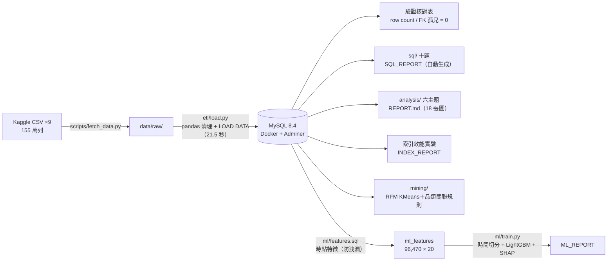
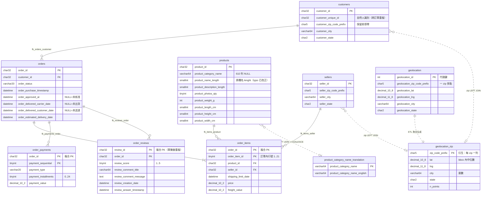

# mysql-ecommerce-analytics

把 [Olist 巴西電商公開資料集](https://www.kaggle.com/datasets/olistbr/brazilian-ecommerce)
（9 個 CSV、155 萬列真實交易）從 raw CSV 一路做到機器學習：**Docker MySQL 8.4 正規化倉庫
→ SQL 分析與探勘 → SQL 時點特徵 → LightGBM 晚到預測**。全案以 SQL 為核心，
所有數字皆真實執行可重現（固定種子、uv.lock 鎖版本）。

## 三個招牌數字

| | 數字 | 出處 |
|---|---|---|
| 索引效能實驗 | **9.2× 加速**（59.6→6.4ms，覆蓋索引；並實證 OLAP 聚合追加索引無效 ~1.0×） | [INDEX_REPORT](results/INDEX_REPORT.md) |
| 晚到預測 | **AUC 0.750**，最強單特徵 baseline 僅 0.500、跨州規則 0.401（時間切分＋防洩漏時點特徵） | [ML_REPORT](results/ML_REPORT.md) |
| 客戶結構 | **96.9% 客戶只買一次**、6 個月累積二購率 3.2%——RFM/cohort 全部圍繞這個殘酷事實誠實設計 | [REPORT](reports/REPORT.md) |

## 架構流程



## 三階段

| Stage | 內容 | 主要交付 |
|---|---|---|
| A 倉庫 | Docker MySQL 8.4、9 表 schema（6 條 FK 孤兒實測 0）、ETL 155 萬列 21.5 秒、核對表驗證 | [schema.sql](schema.sql) |
| B 分析與探勘 | 十題 SQL（一題一檔）＋六主題深度報告（21 查詢/18 圖）＋索引實驗＋RFM 分群＋關聯規則 | [SQL_REPORT](results/SQL_REPORT.md)、[REPORT](reports/REPORT.md)、[INDEX_REPORT](results/INDEX_REPORT.md)、[ASSOCIATION_REPORT](results/mining/ASSOCIATION_REPORT.md) |
| C 機器學習 | SQL 時點特徵（200 筆性質測試＋4 手工案例防洩漏，**驗證不過不准訓練**）、LightGBM vs 三 baseline、SHAP | [ML_REPORT](results/ML_REPORT.md)、[ml/](ml/) |

精選發現：晚到 8+ 天的訂單平均評分從 4.29 崩至 **1.70**（79.3% 給 1-2 星）；
州際配送差 **3.4 倍**（SP 8.7 天 vs RR 29.3 天）；74 品類中前 18 個吃掉 81.3% GMV；
跨品類共購僅 0.81%（關聯規則的誠實負面結果＋條件宇宙 Top 組合）。

## Quick Start（一鍵重現）

```bash
make all        # db-up → fetch → etl → verify → sql → mine → train
```

無 make 的環境（如 Windows）直接照抄對應指令：

| make 目標 | 等效指令 |
|---|---|
| `db-up` | `docker compose up -d --wait` |
| `fetch` | `uv run python scripts/fetch_data.py`（需 `~/.kaggle` 憑證；已有 CSV 自動跳過） |
| `etl` | `docker compose exec -T mysql sh -c '…mysql…' < schema.sql`＋`uv run python etl/load.py` |
| `verify` | `uv run python scripts/run_verify.py` |
| `sql` | `uv run python scripts/run_sql.py`＋`uv run python scripts/run_analysis.py` |
| `mine` | `uv run python mining/rfm_clustering.py`＋`uv run python mining/association_rules.py` |
| `train` | `make features` 後 `uv run python ml/train.py`（開頭強制防洩漏驗證） |

前置：Docker Desktop、[uv](https://docs.astral.sh/uv/)、`.env`（見 [.env.example](.env.example)）。
無 Kaggle 憑證者可手動放 CSV 進 `data/raw/` 後從 `etl` 起跑。
日常開關與細節見 [docs/OPERATIONS.md](docs/OPERATIONS.md)。

## ER Diagram

實線 = 實體 FK（6 條，孤兒實測全 0）；虛線 = 刻意**不建 FK** 的分析用 LEFT JOIN 關係
（zip 不唯一且有缺值、品類缺英譯——理由見 [schema.sql](schema.sql) 註解）。



## 工程與方法論重點

- **口徑治理**：GMV（items）與金流（payments）兩口徑不可互驗、一單多評取最新、
  完整月 2017-01~2018-08——全案單一定義，view 集中實作（`v_order_gmv` 防 fan-out）。
- **誠實紅線**：所有數字真實執行；殘月灰化、cohort 右截斷灰格、色階上限誠實、禁雙軸；
  關聯規則的負面結果（99.2% 單品類訂單）如實呈現。
- **防洩漏**：時點特徵「已揭曉/存在/在途」三口徑分離；性質測試曾實際抓到
  MySQL 整數相除截斷 bug；時間切分 train/val/test 嚴格遞增。
- 模型可解釋性（SHAP 個體歸因、部分依賴）在我的另一個專案 **credit-default-xai**
  有完整展開，本專案以全局重要度驗收特徵工程。

## 資料來源與授權

資料來自 Kaggle [Brazilian E-Commerce Public Dataset by Olist](https://www.kaggle.com/datasets/olistbr/brazilian-ecommerce)
（License: **CC BY-NC-SA 4.0**）。本 repo **不隨附原始資料**，僅提供下載腳本
（`scripts/fetch_data.py`，需自備 Kaggle API 憑證）；分析產出（圖表、聚合表、報告）
屬衍生著作，沿用相同授權精神、僅供學習展示。

## 文件索引

[docs/OPERATIONS.md](docs/OPERATIONS.md)（開關機手冊）
