# Olist 巴西電商分析報告（Stage B：SQL 分析）

以 [Olist 巴西電商公開資料集](https://www.kaggle.com/datasets/olistbr/brazilian-ecommerce)
（2016-09 ~ 2018-10、約 10 萬筆真實訂單）建成的 MySQL 8 正規化倉庫（Stage A）為基礎，
用純 SQL（CTE、window function、條件聚合）回答六組商業問題。
所有數字皆為實際查詢輸出，可溯源至 [`tables/`](tables/) 的 CSV 與
[`../analysis/`](../analysis/) 的對應查詢（標注於各節「方法」）。
規格交付層（十題一題一檔、索引實驗、RFM 分群與關聯規則探勘）見
[`../results/`](../results/) 與 [`../mining/`](../mining/)。

## KPI 總覽

| 指標 | 數值 | 來源 |
|---|---|---|
| 資料期間 | 2016-09-04 ~ 2018-10-17 | Stage A 剖析 |
| 總訂單數 | 99,441（delivered 96,478，97.0%） | Stage A 驗證 |
| **GMV（delivered 口徑）** | **R$ 15,419,773.75** | v_order_gmv 加總 |
| 自然人客戶數（有 delivered 訂單） | 93,358 | 02 / 2-2 |
| **回購率** | **3.0%**（2,801 / 93,358 人） | 02 / 2-2 |
| 平均評分（每單最新評論） | 4.09 / 5 | 06 / 6-0 |
| 中位配送天數 | 10 天（平均 12.5、P90 23） | 05 / 5-0 |
| 交期準時率 | 93.2% | 05 / 5-0 |

> **閱讀前必知**
> 1. **兩種營收口徑不可互驗**：本報告的 GMV＝`SUM(price + freight_value)`（order_items，
>    商品面）；金流面＝`SUM(payment_value)`（order_payments，含分期總額、voucher 折抵、
>    多重付款）。兩者定義不同，差異不是資料錯誤，全文一律使用 GMV 口徑。
> 2. **主分析區間 = 2017-01 ~ 2018-08 共 20 個完整月**。2016-09/10/12 是平台冷啟動稀疏期
>    （4 / 324 / 1 筆，2016-11 整月缺）、2018-09/10 是資料截尾殘月（0 筆 delivered）——
>    第 1 章的全量圖以灰色呈現它們，其餘章節直接裁剪。
> 3. 一單多評（547 筆訂單）一律取**最新一筆**評論；敏感度對照顯示與平均法整體均分僅差
>    0.0005（4.0863 vs 4.0868），口徑選擇不影響結論（06 / 6-0）。

---

## 1. 月營收與成長

**問題**：平台營收規模與成長動能如何？單均價值有沒有隨規模稀釋？

**方法**：`analysis/01_revenue.sql`（Q1）——orders ⋈ v_order_gmv 按月聚合，
`LAG()` 算 MoM，且僅在「本月與前月皆完整月」時計算（避免對殘月算出假成長）。

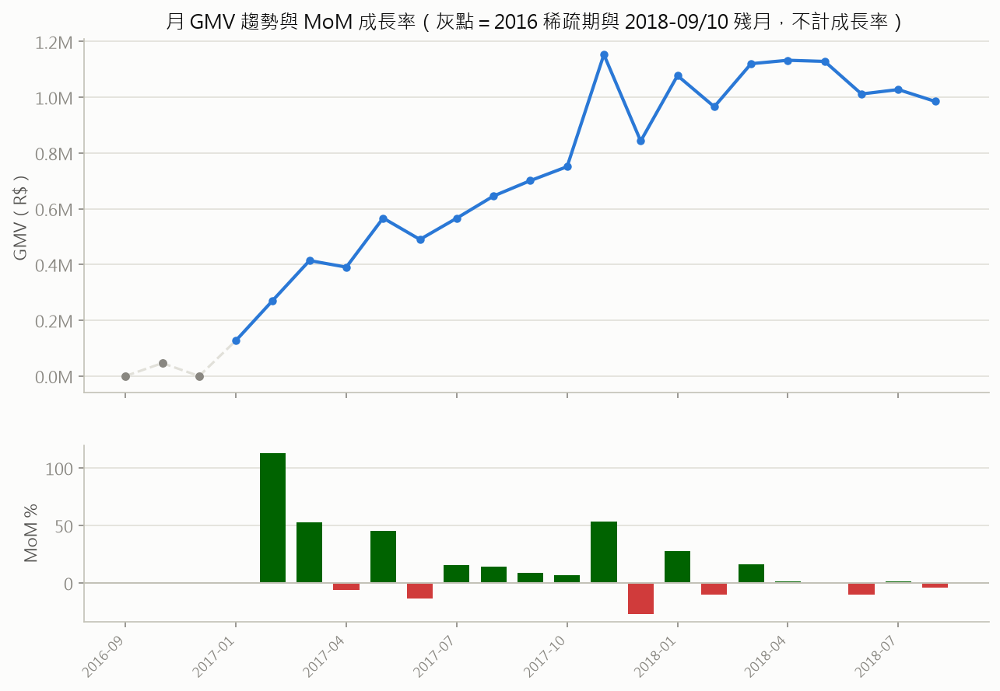
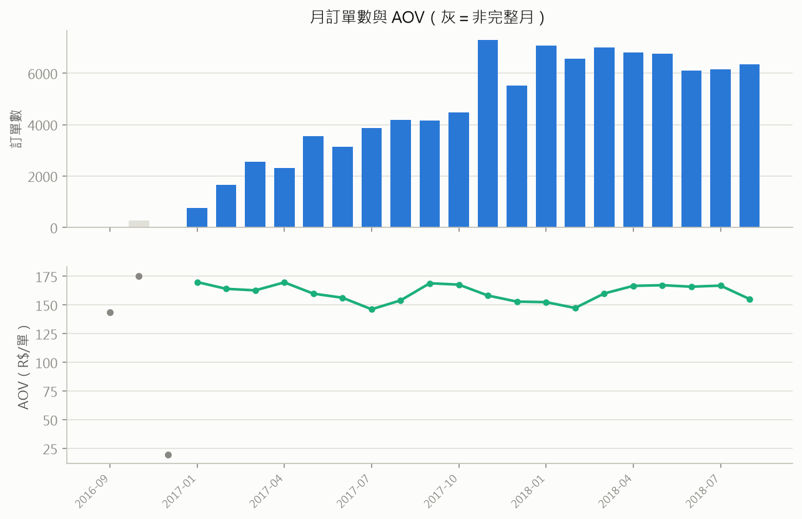

**發現**
1. 2017 年是高速成長年：GMV 從 1 月的 R$ 127K 成長到 11 月峰值 **R$ 1.15M**
   （黑色星期五單月 +53.6%）；2018 年進入 **R$ 1.0M ± 10% 的平原期**，
   最後四個完整月（2018-05~08）MoM 皆在 ±5% 內。
2. **AOV 在完整月間穩定於 R$ 146~170**（整體約 R$ 160）——成長來自訂單量，
   不是客單價；擴張沒有稀釋單均價值。
3. 2017-11 的黑五尖峰隔月即回落（12 月 −26.9%），屬大促脈衝而非階梯式升級。

---

## 2. RFM 客戶分群

**問題**：客戶價值結構長什麼樣？行銷預算該花在誰身上？

**方法**：`analysis/02_rfm.sql`（2-1 ~ 2-5）——以 `customer_unique_id` 折疊自然人；
R 基準日取資料內最大 delivered 下單日（不用 `NOW()`，可重現）；R、M 用 `NTILE(5)`。
**F 不用 NTILE**：97.0% 客戶 F=1，NTILE 會把同值硬切五箱（切法由排序隨機性決定），
改用固定分箱（1 次 / 2 次 / 3+ 次）——這是本資料集 RFM 方法論上最重要的修正。

| F 分箱 | 人數 | 佔比 |
|---|---:|---:|
| F=1 一次客 | 90,557 | 97.0% |
| F=2 二次客 | 2,573 | 2.76% |
| F≥3 多次客 | 228 | 0.24% |

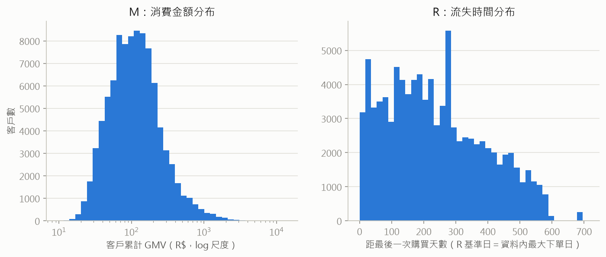
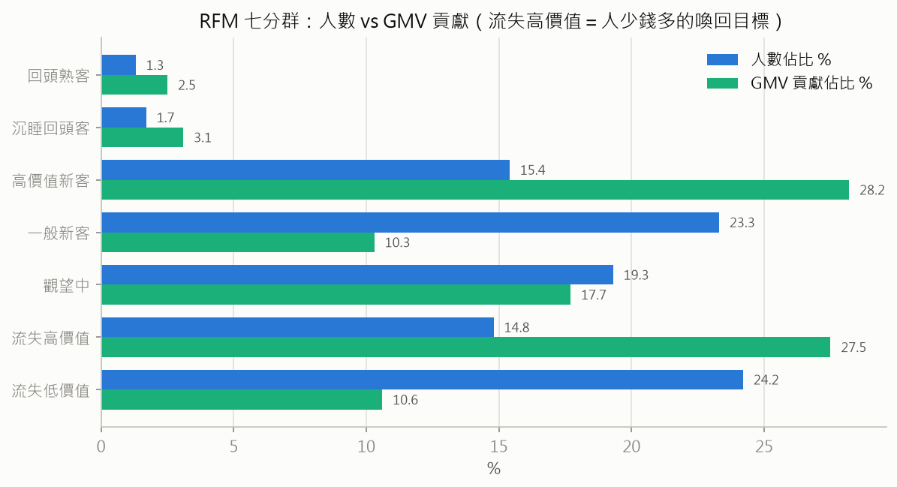
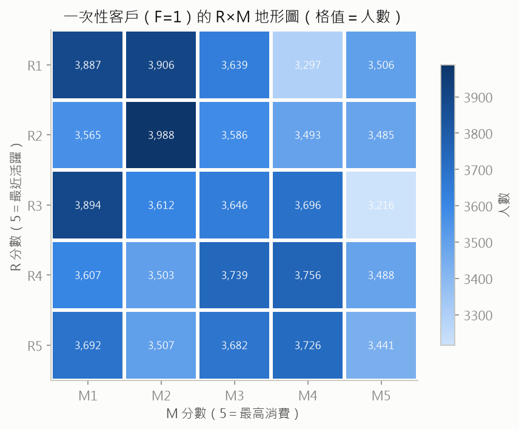

**發現**
1. **Olist 是結構性一次購買平台**（客戶關係屬賣家、平台是收單通路），教科書式
   「忠誠客維繫」敘事在此不成立；有意義的問題是「一次性客戶海裡，誰值得喚回」。
2. 答案是「**流失高價值**」群：**13,781 人（14.8%）貢獻了 27.5% 的 GMV**
   （人均 R$ 307.77，平均已流失 393 天）——人數佔比與 GMV 貢獻差近一倍，
   是喚回行銷 ROI 最高的名單。「高價值新客」（15.4% 人 / 28.2% GMV）則是保鮮對象。
3. 真正的回頭客極稀有：回頭熟客僅 1,201 人（1.3%）。R×M 地形圖顯示人數在
   R×M 各格分布均勻——流失不挑客層，高價值客戶同樣在流失。

**州別集中度**（2-5）：SP 一州佔 **37.4%** GMV，前 7 州（SP/RJ/MG/RS/PR/SC/BA）
累積 80.9%；離群有趣點：東北部州客單價明顯較高（PB 人均 R$ 273 vs SP R$ 147），
與第 5 章「北部運費高、配送慢」互為表裡——買一次的成本高，買的金額就大。

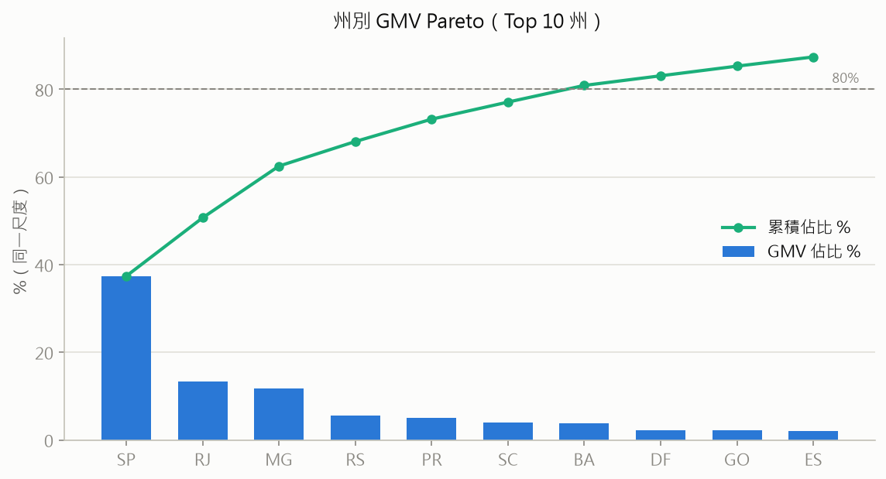

---

## 3. Cohort 留存與回購

**問題**：新客首購後還會回來嗎？會回購的人多快回購？

**方法**：`analysis/03_cohort.sql`（3-1 ~ 3-3）——cohort = 首購月（2017-01 ~ 2018-08）；
右截斷格（cohort 月＋月齡超出資料期）不輸出、圖上塗灰，**不畫成 0%**；
月齡只看 0–6（3% 回購率攤到更遠月齡全是雜訊）。
二購率曲線與畫像對比都限「首購 ≤ 2018-02」，讓每個人都有 6 個月觀察窗
（否則 2018 年中後首購、沒時間回購的人會被誤標成「不回購」——右截斷偏誤）。

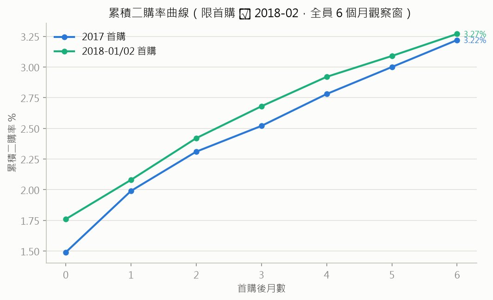
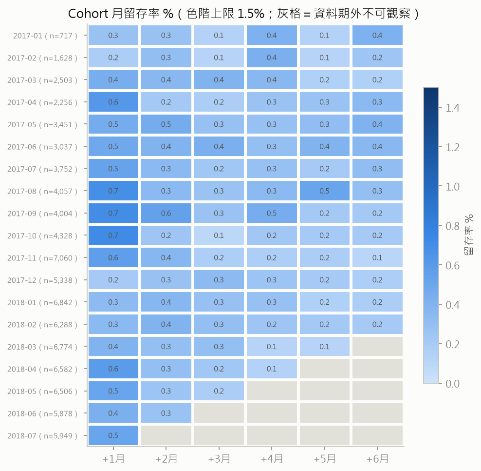

**發現**
1. **6 個月累積二購率僅 3.2%**（2017 cohort）；2018 年初 cohort 3.27%——平台成熟
   帶來的改善只有 0.05 個百分點，留存結構沒有實質變化。
2. 月留存率全面落在 **0.1% ~ 0.7%**；熱圖格間差異多在抽樣雜訊範圍內
   （cohort 數千人 × 留存 <1%），不建議對單格過度解讀——這正是把曲線
   （而非熱圖）當招牌圖的原因。
3. **二購黃金窗口在第一週**：會回購的人裡 36.7% 在首購 7 天內完成二購、
   累計 50.6% 在 30 天內（3-2）——喚回預算應集中在首購後一個月內投放。
4. 回購者 vs 一次性客戶的首單畫像差異很小（3-3）：首單 GMV R$ 143 vs 158、
   首單評分 4.20 vs 4.13、分期 3.39 vs 2.96 期——**首單特徵幾乎不預測回購**，
   誠實結論是：想靠「找出天生會回購的客人」不如靠「第一週的再行銷動作」。

| 二購間隔 | 人數 | 佔比 |
|---|---:|---:|
| 0-7 天 | 1,028 | 36.7% |
| 8-30 天 | 388 | 13.9% |
| 31-60 天 | 296 | 10.6% |
| 61-90 天 | 196 | 7.0% |
| 91-180 天 | 413 | 14.7% |
| 180+ 天 | 480 | 17.1% |

---

## 4. 品類與商品

**問題**：哪些品類撐起營收？集中度多高？運費吃掉多少？

**方法**：`analysis/04_category.sql`（4-1 ~ 4-4）——品類名以
`COALESCE(英譯, 葡文原名, '(uncategorized)')` 統一；佔比在全集合算完才取 Top N；
累積佔比 window 明寫 `ROWS UNBOUNDED PRECEDING`；運費佔比「先加總再相除」
（平均每單比率會被小額訂單放大，是常見錯誤）。

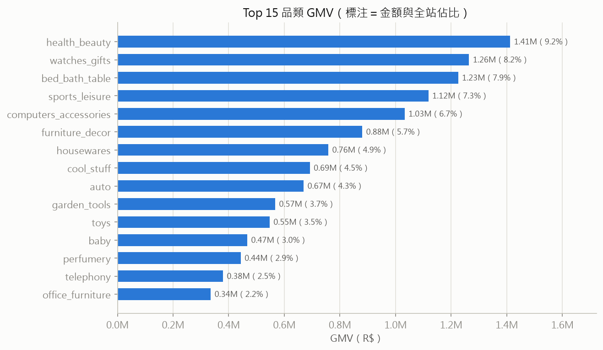
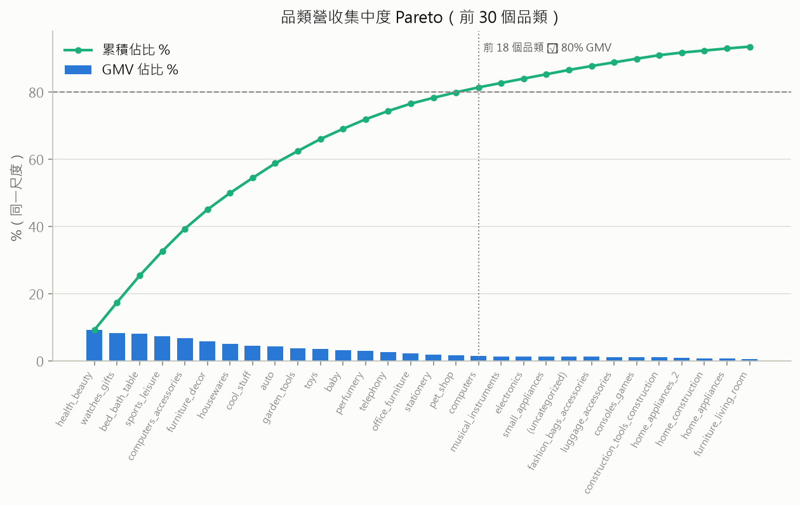
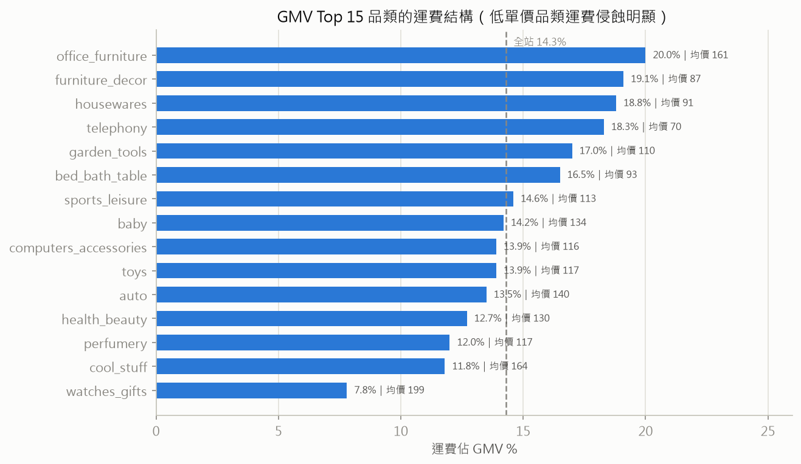

**發現**
1. 頭部品類是 health_beauty（R$ 1.41M、9.2%）、watches_gifts（8.2%）、
   bed_bath_table（7.9%）；**74 個品類中前 18 個吃掉 81.3% GMV**，
   Top 15 合計 76.5%——中度集中，沒有單一品類獨大（第一名也只有 9.2%）。
2. 商品層更集中：**Top 1% 商品（322 個）貢獻 23.7% GMV，Top 10% 貢獻 59.2%**
   （4-3，售出商品共 32,216 個）——平台同時吃爆品與長尾。
3. **運費全站平均佔 GMV 14.3%**，結構性差異明顯：高單價的 watches_gifts 僅 7.8%，
   低單價/大件的 office_furniture 20.0%、furniture_decor 19.1%、telephony 18.3%
   （均價 R$ 70）——低價大件品類的運費侵蝕是毛利改善的首要目標。

---

## 5. 物流時效

**問題**：從下單到送達要多久？預估交期準嗎？延遲卡在哪一段、哪些州最慘？

**方法**：`analysis/05_logistics.sql`（5-0 ~ 5-6）——母體 = delivered 且送達時間非
NULL（排除 8 筆）；準時判定用 `DATE(delivered) <= DATE(estimated)`
（estimated 只有日期，比 timestamp 會把當天下午送達誤判成晚到）；
`on_time_rate = AVG(delay_days <= 0)`（正負號寫反整章就反了）。
資料品質盤點（5-0）：時間順序異常 0 筆、carrier 日缺 1 筆，分析母體 96,470。

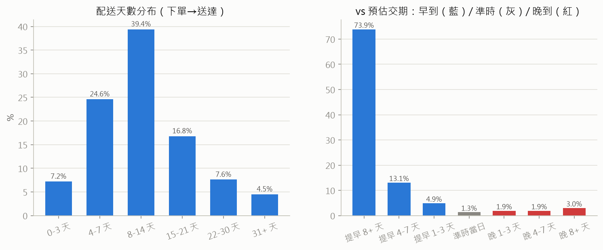
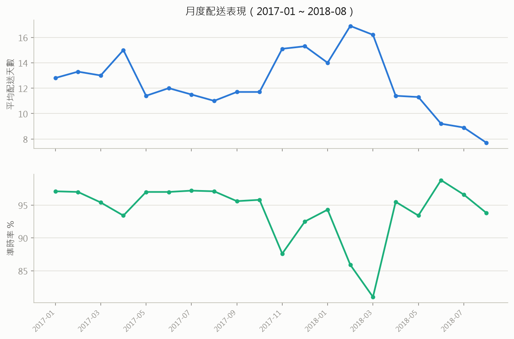
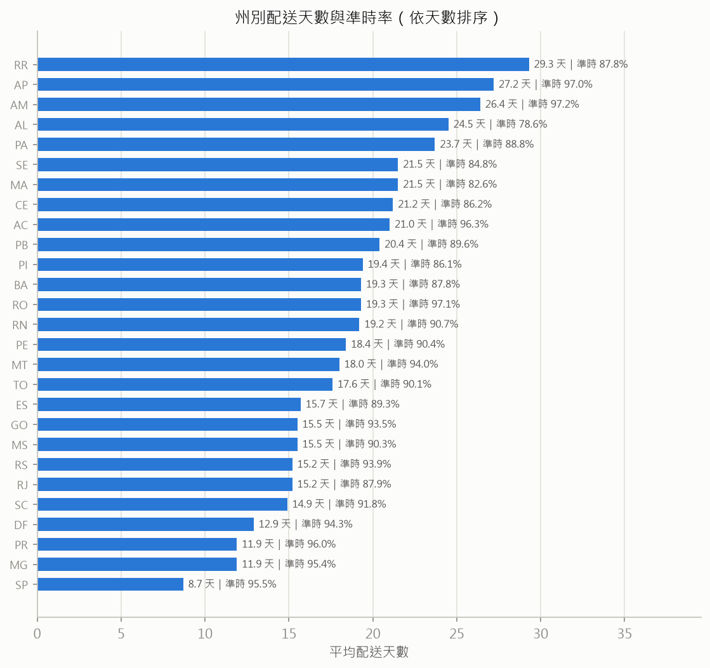
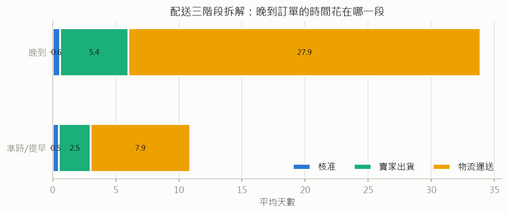

**發現**
1. 中位配送 **10 天**（平均 12.5、P90 23 天）；**91.9% 訂單提早到貨、73.9% 提早
   8 天以上**——Olist 的預估交期極度保守（buffer 過大），代價是尾巴：6.8% 晚到，
   其中晚 8+ 天的佔 3.0%（2,862 筆），正是第 6 章評分崩盤的族群。
2. **延遲的歸因在物流運送段**（5-6）：晚到訂單平均在途 27.9 天 vs 準時組 7.9 天
   （核准 0.6 vs 0.5、賣家出貨 5.4 vs 2.5——賣家慢一點，但主因是運送）。
3. **州際差距 3.4 倍**：SP 平均 8.7 天（準時率 95.5%）vs 北部 RR 29.3 / AP 27.2 /
   AM 26.4 天；東北部 AL 準時率最低（78.6%）。跨州物流是結構性弱點。
4. 月度趨勢（5-3）看得到兩次危機：2017-11 黑五（準時率 87.6%）與
   **2018-02/03 物流危機（85.9% / 81.0%，全期最低）**；2018 年中修復並進步到
   平均 7.7~9.2 天、為全期最佳——營運有在學習。
5. 賣家端（5-5）：整體逾期交貨率 9.3%，但尾部集中——最差的賣家逾期率 59.5%
   （n=84），Top 20 名單全部 >35%，是平台治理（下架/加壓）的直接名單。

---

## 6. 評論與滿意度

**問題**：滿意度結構長怎樣？物流是不是差評首因？差評集中在哪些品類？

**方法**：`analysis/06_reviews.sql`（6-0 ~ 6-4）——母體 = delivered 訂單的最新評論
（與物流章同基底，延遲×評分可無縫互讀）；品類低分率以 order×category 去重
（多品項訂單同品類只計一次）、n ≥ 200 過濾小樣本。文字內容（NLP）留給 Stage C。

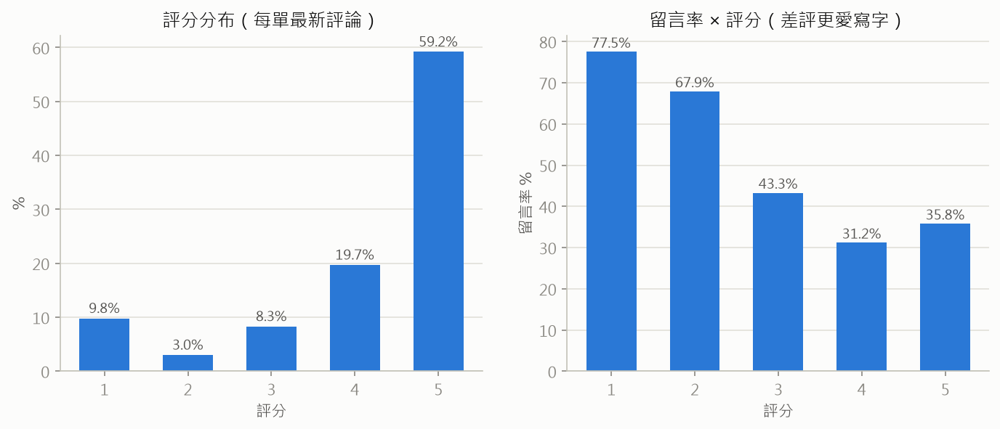
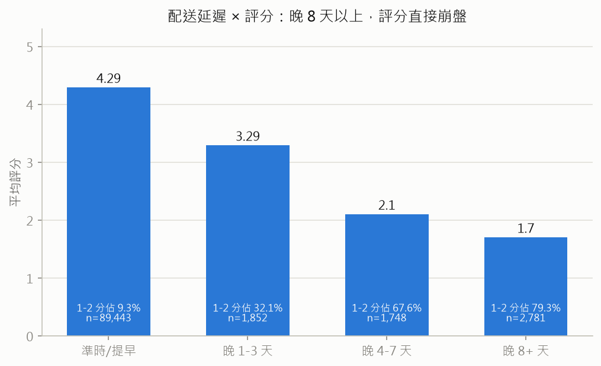
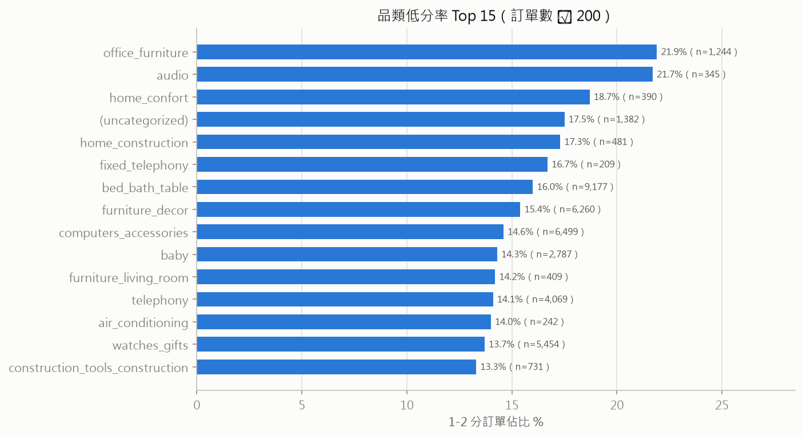

**發現**
1. J 型分布：59.2% 給 5 星、12.8% 給 1-2 星；平均 4.09。
2. **本報告招牌發現——物流延遲是滿意度的頭號殺手**：準時訂單平均 4.29 分
   （1-2 星佔 9.3%）→ 晚 1-3 天掉到 3.29 → 晚 4-7 天 2.10 → **晚 8+ 天 1.70 分、
   79.3% 給 1-2 星**。與第 5 章合讀：3.0% 的嚴重晚到訂單製造了不成比例的差評。
3. **差評者更愛寫字**：1 星留言率 77.5%（平均 100 字）vs 5 星 35.8%（52 字）——
   低分留言是密度最高的客訴文本，Stage C 的 NLP 應從這裡下手。
4. 品類低分率榜首是 **office_furniture（21.9%）**、audio（21.7%）、
   home_confort（18.7%）——大件（物流慢、易損）與期待落差型品類；
   與第 4 章合讀，office_furniture 同時是「運費佔比最高」與「低分率最高」，
   是品類治理的第一優先。

---

## 附錄

### 口徑定義

| 名詞 | 定義 |
|---|---|
| GMV | `SUM(order_items.price + freight_value)`，僅 delivered 訂單 |
| AOV | 月 GMV ÷ 月訂單數（COUNT DISTINCT order_id） |
| 自然人客戶 | `customer_unique_id`（customer_id 是每單一個的訂單維度身分） |
| 回購率 | 有 ≥2 筆 delivered 訂單的自然人 ÷ 全體有 delivered 訂單的自然人 |
| 準時 | `DATE(order_delivered_customer_date) <= DATE(order_estimated_delivery_date)` |
| 每單評分 | 該訂單最新一筆評論（v_order_review） |

### 共用 view（analysis/00_views.sql）

- `v_order_gmv`：訂單粒度 GMV 與品項數——集中防「先 JOIN 再 SUM」的 fan-out 重複計數。
- `v_order_review`：每訂單最新一筆評論——集中一單多評口徑。

### 重現方式

```powershell
docker compose up -d                          # MySQL 8.4（Stage A 基礎設施）
uv run python etl/load.py                     # 需先完成 Stage A 載入（約 22 秒）
uv run python scripts/run_analysis.py         # 本報告全部表格與圖表（約 16 秒）
```
