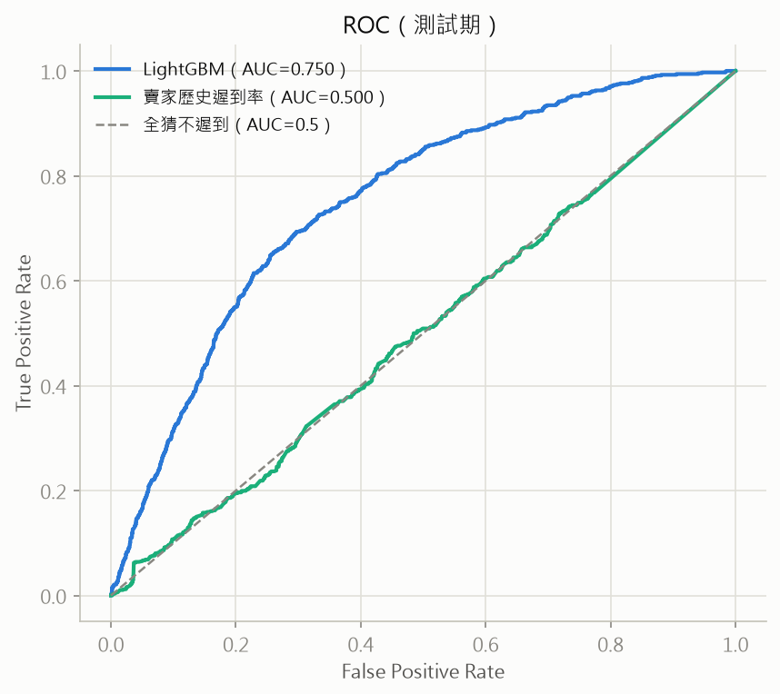
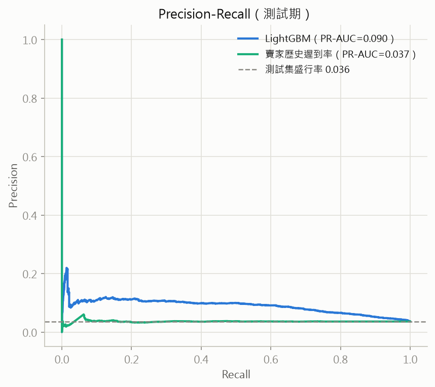
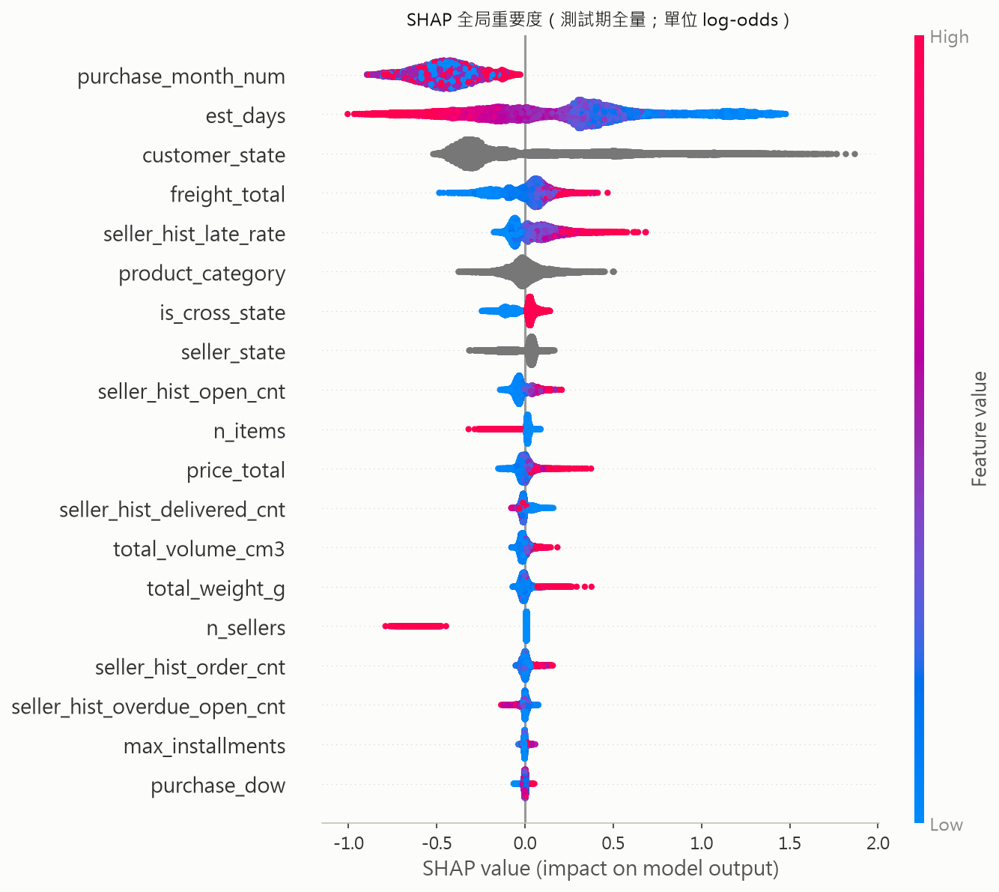

# 晚到預測模型報告（LightGBM）

> 任務：在**下單當下**預測「訂單是否會比預估日期晚送達」。
> 特徵工程全在 SQL（[`ml/features.sql`](../ml/features.sql)）、訓練評估在
> [`ml/train.py`](../ml/train.py)；所有數字為真實執行輸出，可溯源
> [`ml_metrics.json`](ml_metrics.json)。SEED=42、超參固定，結果可重現。

## 1. 任務與口徑

- Label：`is_late = DATE(實際送達) > DATE(預估送達)`（DATE 級比較，沿用全案口徑）。
- 母體：delivered 且有送達時間、預估日非 NULL、無時間倒置 = **96,470 筆**；
  全域晚到率 **6.77%**。
- **禁用欄位**（洩漏黑名單）：`order_delivered_*`（構成 label／t 後才發生）、
  `order_reviews.*`（label 下游）、`order_approved_at`（t 後）、
  `shipping_limit_date`（由 approved 推導，保守排除）、任何 delivery_days 衍生量。

## 2. 時點特徵與防洩漏驗證（本階段可信度核心）

主賣家（訂單品項金額最高者）在購買時點 t 的歷史狀態，三個口徑嚴格分離：

| 特徵 | 口徑 | 為什麼 |
|---|---|---|
| `seller_hist_late_rate` | 分母僅計 **delivered < t**（嚴格小於）的歷史單 | t 時「結果已揭曉」的單才可用；冷啟動 = NULL（5,263 筆，不補先驗——全域先驗含測試期資訊） |
| `seller_hist_order_cnt` | **全狀態 orders**、purchase < t | 若只算 delivered 單＝偷看歷史單的最終結局（設計審查抓到的定義級洩漏，已修） |
| `seller_hist_open_cnt` / `overdue_open_cnt` | 在途單／其中預估日已過者 | 「t 時已知的賣家壅塞度／已知必遲到」訊號 |

**驗證（`ml/test_features.py`，train.py 開頭強制執行、不過不准訓練）**：
1. **性質測試**：固定種子抽 200 筆，pandas 從**原始表**獨立重算全部特徵精確比對
   （與 features.sql 邏輯零共用，防循環論證）——曾實際抓到一個 bug：MySQL 整數相除
   預設只留 4 位小數，`late_rate` 被截斷（0.1111 ≠ 0.1111…），已改 `CAST AS DOUBLE`。
2. **手工案例 4 筆**（人工逐列讀賣家原始歷史核算後硬編碼）：冷啟動首單／一般手算
   （6 單、4 已揭曉、2 遲到 → rate=0.5）／**在途單排除**（購於 t 前、送達於 t 後：
   計入接單量、不入分母）／**shipped 永未送達單**（證明接單量從全狀態算）。
3. 全域 sanity：母體 96,470、晚到率 0.0677、open≥0、`late_rate IS NULL ⇔ 分母=0`。

## 3. 時間切分（月界動態，後 20% 測試）

| 段 | 月份 | 列數 | 占比 | 晚到率 |
|---|---|---:|---:|---:|
| train | 2016-09 ~ 2018-04 | 71,118 | 73.7% | 7.62% |
| val（早停＋選閾值） | 2018-05 | 6,749 | 7.0% | 6.56% |
| test | 2018-06 ~ 2018-08 | 18,603 | 19.3% | **3.61%** |

- 三段時間嚴格遞增。**測試期晚到率只有 3.61%**（全域 6.77%）——2018 年中物流全期最佳
  （Stage B 5-3 實測）＋輕微尾端 censoring，因此所有 PR 類指標一律以
  **測試期實際盛行率 0.0361** 為基準，用全域值會誤導。
- 賣家歷史特徵跨越切分點**不是洩漏**：每筆訂單只用「其購買時點之前已實現」的資訊，
  生產環境預測當下同樣可得；時間切分防的是「測試期資訊影響模型參數」，兩者正交。

## 4. 模型設定

LightGBM 4.6，超參**固定不搜參**（避免「搜參是否碰了測試集」的質疑）：
`lr=0.05, num_leaves=63, min_child_samples=50, colsample/subsample=0.9,
reg_lambda=1.0, n_estimators=2000＋早停100`（實際 best_iteration=**68**）；
類別特徵（customer_state / seller_state / product_category）用原生 categorical、
levels 以訓練集為準；**不加 scale_pos_weight**（保機率排序，操作點交給閾值）。

## 5. 結果（測試期 18,603 列、盛行率 0.0361）

| 模型 | AUC | PR-AUC | Precision | Recall | F1 |
|---|---:|---:|---:|---:|---:|
| **LightGBM** | **0.7495** | **0.0897** | 0.087 | 0.650 | 0.153 |
| A 全猜不遲到 | 0.5000 | 0.0361 | 0 | 0 | 0 |
| B 跨州即遲到 | 0.4009 | 0.0314 | 0.025 | 0.405 | 0.046 |
| C 賣家歷史遲到率單特徵 | 0.4996 | 0.0367 | — | — | — |

- **PR-AUC 0.0897 = 盛行率的 2.5 倍**；**precision@top-10% = 10.7%（3.0 倍 lift）**——
  給客服「優先關注名單」的實際效益口徑。
- **兩個 baseline 的教訓比勝負更有價值**：
  - 跨州規則 AUC **0.4009 < 0.5**——測試期（2018 年中）跨州訂單反而**更準時**，
    2018 物流改善主要發生在長途線路；靜態規則在分布漂移下直接反噬。
  - 賣家歷史遲到率單特徵 AUC **0.4996**——在新物流政權下，舊政權學到的賣家風險
    幾乎失去鑑別力；模型的優勢來自**組合訊號**（承諾天數、州別、月份、運費），
    而非任何單一特徵。
- 混淆矩陣（閾值 = val max-F1 = 0.0642）：TP 437 / FN 235 / FP 4,612 / TN 13,319
  ——抓到 65% 的晚到單，代價是每 1 個真晚到伴隨約 10.6 個誤報；
  **0.5 閾值對照：全判不遲到**（TP=0）——教材級的不平衡任務閾值示範。
  閾值屬業務參數，應依「漏抓一單晚到 vs 誤關注一單」的成本重調。
- 各月 AUC：2018-06 = 0.792、07 = 0.674、08 = 0.701（樣本各 ~6.1-6.4K）。

## 6. SHAP 全局重要度（測試期全量）

前五名解讀：
1. **purchase_month_num**——時代 proxy：模型學到「越近期物流越好」。這是時間漂移
   的誠實映照而非季節性（見限制 3），生產部署應改用「距今月齡」類特徵。
2. **est_days**——承諾越短（藍，圖右）風險越高：平台縮短承諾天數直接加大違約機率，
   它出現在 label 公式的一側但**在下單當下完全已知，不是洩漏**。
3. **customer_state**——北部／東北部州拉高風險（呼應 Stage B 州別配送 3.4 倍差距）。
4. **freight_total**——低運費（藍）偏高風險，與短程/輕件的承諾更緊有關。
5. **seller_hist_late_rate**——方向正確（高歷史率→高風險），但邊際貢獻已被
   州別/承諾天數吸收大半，與 Baseline C 的失效互為印證。

> 模型可解釋性（SHAP 個體歸因、部分依賴、反事實）在我的另一個專案
> **credit-default-xai** 有完整展開；本專案以全局重要度驗收特徵工程。

## 7. 限制與後續

1. **尾端 censoring**：越接近資料快照終點，未送達（多為慢件）訂單被母體排除的
   比例越高——實測 2018-06/07/08 各月被排除 1.15% / 2.16% / 2.47%（2018-09/10 為
   100%，已整月不在母體）。測試期指標整體**偏樂觀**。
2. **條件化母體**：模型學的是 P(晚到 | 最終有送達)；上線對象包含最終取消/遺失的單。
3. **月份特徵的時代性**：purchase_month_num 在本資料集實質是 regime 指標
   （訓練期只有一個 2017-11 黑五）；跨年部署需改造。
4. 機率校準未做（平均預測機率會高於測試期實際盛行率——訓練期晚到率較高所致）；
   營運使用建議先做 isotonic/Platt 校準。
5. 冷啟動賣家（5.5%）依賴 NULL 分支；可試訓練折內的貝氏平滑先驗。
